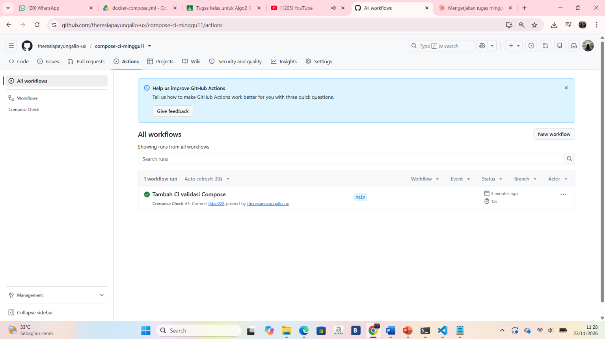
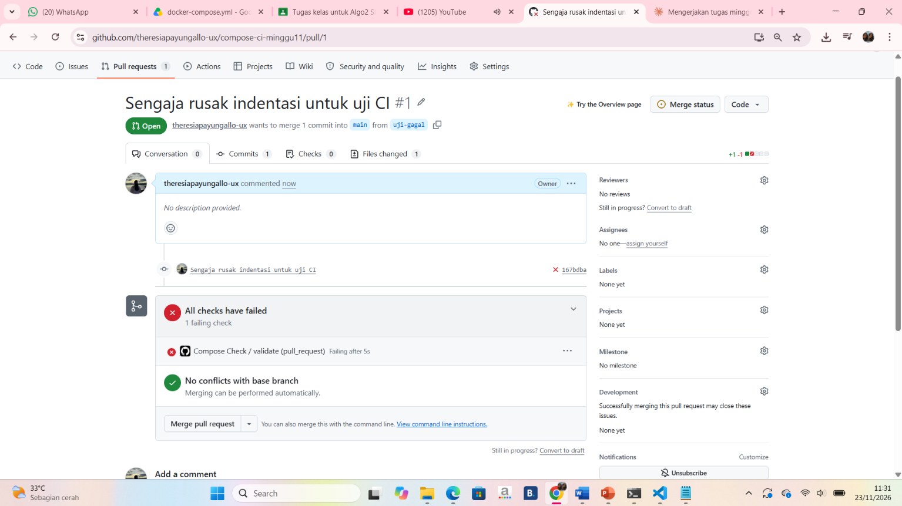
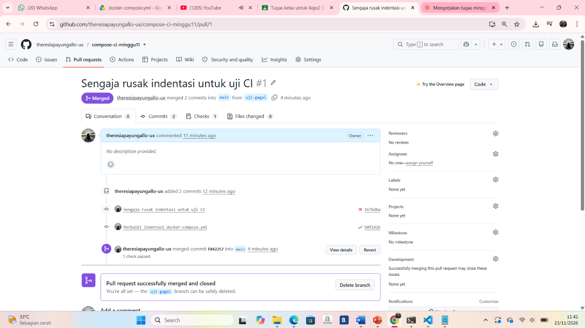

# Tugas Minggu 11: CI untuk Repo Compose

**Nama:** Theresia Payung Allo
**NIM:** 202557201015
**Mata kuliah:** Teknologi Open Source

## Deskripsi
Workflow ini memvalidasi sintaks file docker-compose.yml (stack WordPress + MySQL) secara otomatis memakai docker compose config -q. Workflow berjalan setiap ada push ke branch main dan setiap ada Pull Request.

## Isi repositori
- .github/workflows/compose-check.yml : workflow CI
- docker-compose.yml : stack WordPress + MySQL (tugas minggu 10)
- .env.example : contoh variabel lingkungan tanpa rahasia asli
- .gitignore : mengabaikan .env

## Cara kerja workflow
Pemicunya ada dua: push ke branch main dan pull_request. Workflow punya satu job bernama validate yang berjalan di runner ubuntu-latest dengan tiga step. Step pertama (checkout) mengambil kode repo ke runner. Step kedua menjalankan cp .env.example .env, karena file .env asli tidak ada di repo dan variabel di docker-compose.yml perlu nilai. Step ketiga menjalankan docker compose config -q untuk memeriksa sintaks file Compose tanpa menjalankan container. Jika ada kesalahan, step ketiga gagal dan check berwarna merah.

## Bukti
1. Run hijau di tab Actions

2. Pull Request dengan check gagal (merah)

3. Badge status di README

Tautan Pull Request (sudah hijau dan di-merge): https://github.com/theresiapayungallo-ux/compose-ci-minggu11/pull/1

## Kendala dan cara mengatasinya
Pada Pull Request uji-gagal, saya sengaja menghapus satu spasi di depan baris image: pada docker-compose.yml. Check Compose Check / validate berubah merah, dan log step "Validasi file compose" menampilkan pesan "yaml: line 4, column 19: mapping values are not allowed in this context". Pesan itu menunjuk baris 4 karena baris di bawah image: menjadi lebih menjorok dari baris yang rusak. Saya mengembalikan indentasi image: menjadi 4 spasi, commit, lalu push ke branch uji-gagal yang sama. Check berubah hijau, lalu Pull Request saya merge.

Kendala lain: perintah echo untuk badge sempat gagal dengan pesan "event not found" karena tanda seru di dalam tanda kutip ganda dibaca bash sebagai history expansion. Saya mengatasinya dengan memakai tanda kutip tunggal. Saya juga sempat gagal menyalin tangkapan layar ke folder bukti karena nama file ternyata berekstensi ganda (.png.png) akibat ekstensi yang disembunyikan Windows, lalu saya menyalinnya dengan nama baru lewat perintah cp.

## Refleksi singkat
Dengan CI, kesalahan di file Compose ketahuan beberapa menit setelah push, sebelum digabung ke main. Saya tidak perlu ingat menjalankan pemeriksaan sendiri, dan orang yang membuka repo bisa langsung melihat dari badge bahwa konfigurasinya valid.
